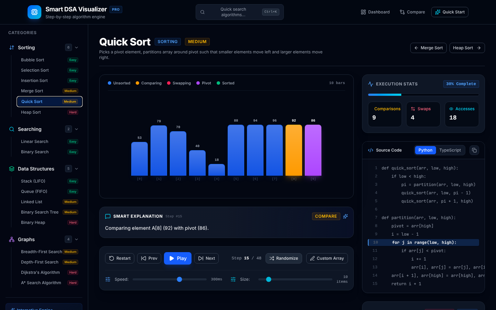
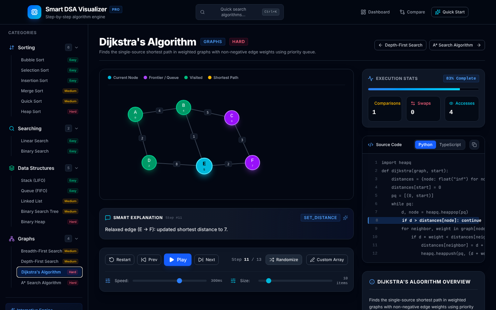
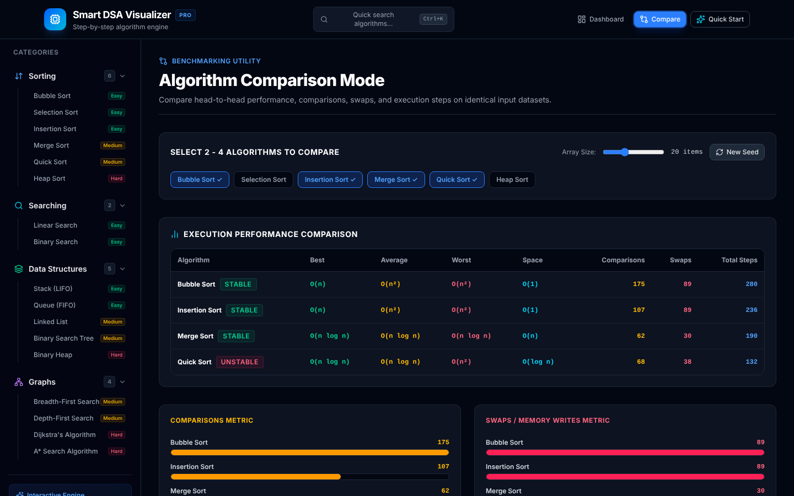

# Smart DSA Visualizer

An interactive web app for learning Data Structures & Algorithms through step-by-step animations, synchronized code highlighting, plain-language explanations of every step, live operation counts and side-by-side algorithm comparison.




| Dijkstra's shortest path | Comparison mode |
|---|---|
|  |  |

---

## Why I Built This

Data Structures and Algorithms are fundamental to computer science and software engineering, yet standard textbook pseudocode and static diagrams often fail to convey the dynamic flow of pointers, state mutations, and recursion loops.

**Smart DSA Visualizer** was built to bridge this gap. Instead of hardcoded video clips, it features a fully decoupled, state-driven execution engine that records high-granularity snapshot streams, allowing users to step forward, step backward, time-travel, inspect comparisons/swaps, and read humanized natural language breakdowns for every single micro-operation.

---

## Key Features

- ⚡ **Decoupled Visualization Engine**: Algorithms emit structured action steps (`COMPARE`, `SWAP`, `PIVOT`, `VISIT`, `PUSH`, `POP`, `ENQUEUE`, `DEQUEUE`, `FOUND`, etc.) separated completely from React UI rendering.
- 🎨 **Modern Developer UI**: Dark mode IDE aesthetic built with Tailwind CSS, Framer Motion, and Lucide React.
- 🔍 **17 Implemented Algorithms & Data Structures**:
  - **Sorting**: Bubble Sort, Selection Sort, Insertion Sort, Merge Sort, Quick Sort, Heap Sort
  - **Searching**: Linear Search, Binary Search
  - **Data Structures**: Stack (LIFO), Queue (FIFO), Singly Linked List, Binary Search Tree (BST), Binary Heap
  - **Graphs**: Breadth-First Search (BFS), Depth-First Search (DFS), Dijkstra's Shortest Path, A* Search Algorithm
- 💬 **Smart Explanation Engine**: Contextual natural language text generator for every step (`"Comparing A[3] (8) and A[4] (5)..."`).
- 💻 **Synchronized Code Panel**: Multi-language tabs (Python & TypeScript) with real-time execution line highlighting matching the exact visualization state.
- 📊 **Real-time Statistics**: Tracks Comparisons, Swaps/Writes, Array Accesses, and progress metrics live during animation.
- ⚔️ **Algorithm Comparison Mode**: Benchmark 2 to 4 algorithms side-by-side on the exact same array seed with comparative bar charts.
- ⌨️ **Keyboard Shortcuts & Accessibility**: Full hotkey support (`Space` = Play/Pause, `Left/Right Arrow` = Step, `R` = Restart, `Ctrl+K` = Quick Search).

---

## Tech Stack

- **Frontend**: React 18 / 19, TypeScript, Vite
- **Styling & UI**: Tailwind CSS v4, Lucide React Icons
- **Animation**: Framer Motion
- **Testing**: Vitest
- **Architecture**: Pure TypeScript Step Engine (State Machine pattern)

---

## Architecture Overview

```
src/
├── algorithms/           # Pure TS algorithm implementations emitting step streams
│   ├── sorting/          # Bubble, Selection, Insertion, Merge, Quick, Heap
│   ├── searching/        # Linear, Binary Search
│   ├── dataStructures/   # Stack, Queue, Linked List, BST, Heap
│   └── graphs/           # BFS, DFS, Dijkstra, A*
├── engine/               # Decoupled visualization runner & state dispatchers
│   ├── visualizationEngine.ts
│   ├── types.ts
│   └── explanationGenerator.ts
├── components/
│   ├── layout/           # Navbar, Sidebar, SearchModal
│   ├── visualization/    # ArrayVisualizer, StackVisualizer, QueueVisualizer, BSTVisualizer, GraphVisualizer
│   ├── controls/         # ControlPanel, Play/Pause/Step/Speed/Size/Custom Modal
│   ├── code/             # CodePanel with line highlighting & tabs
│   ├── stats/            # StatsPanel metrics
│   ├── explanation/      # SmartExplanationPanel
│   └── ui/               # Button, Card, Badge
├── pages/                # Dashboard, VisualizerPage, ComparisonPage
├── hooks/                # useVisualizer, useKeyboardShortcuts
└── types/                # Algorithm, Step, Complexity definitions
```

---

## Installation & Setup

1. **Clone the repository**:
   ```bash
   git clone https://github.com/sahithi-manda/Smart_DSA_Visualizer.git
   cd Smart_DSA_Visualizer
   ```

2. **Install dependencies**:
   ```bash
   npm install
   ```

3. **Run local dev server**:
   ```bash
   npm run dev
   ```

4. **Build for production**:
   ```bash
   npm run build
   ```

---

## Running Unit Tests

39 unit tests cover algorithm correctness across edge cases (empty arrays, duplicate values, reverse sorted, single elements, negative numbers), plus a regression test that graph algorithms receive a valid graph from the engine:

```bash
npx vitest run
```

---

## License

MIT License.
